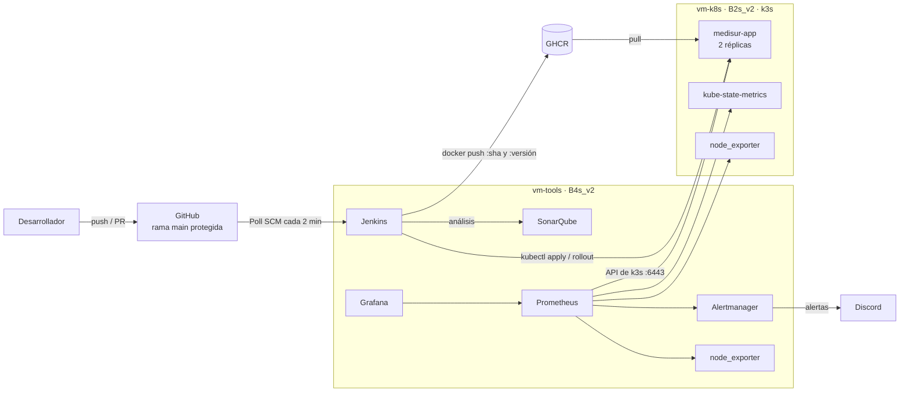

# MediSur: entrega continua sobre Kubernetes

Piloto del trabajo final de Cómputo en la Nube (UANL). Un servicio Flask pequeño que va del `push` a producción sin pasos manuales: pruebas, análisis de calidad, imagen etiquetada con el SHA del commit, despliegue gradual en k3s, prueba de humo, rollback automático y monitoreo con alertas.

## Arquitectura



Dos VMs separadas en la misma red virtual de Azure. El monitoreo vive en `vm-tools`, fuera del clúster que vigila, para que una falla del clúster no apague también la vigilancia.

## Estructura del repo

| Ruta | Qué es |
|---|---|
| `app/` | App Flask (`/health`, `/ready`, `/version`, `/metrics`, `/api/items`), pruebas y `Dockerfile` multietapa |
| `Jenkinsfile` | Pipeline completo de CI/CD |
| `k8s/` | Manifiestos de la app: namespace, ConfigMap, Deployment, Service |
| `k8s/acceso/jenkins.yaml` | Cuenta de servicio de Jenkins con permisos solo sobre el namespace `medisur` |
| `k8s/plantillas/` | Plantillas de secretos (sin valores reales) |
| `scripts/desplegar.sh` | Despliegue + `rollout status` + prueba de humo (lo usa Jenkins) |
| `scripts/rollback.sh` | `rollout undo` (lo usa Jenkins si falla el despliegue) |
| `scripts/preparar-vm-*.sh` | Preparación de cada VM (se corren una sola vez) |
| `monitoreo/` | Prometheus, reglas de alerta y sus pruebas, Alertmanager, Grafana (2 tableros) y lo que se instala en el clúster |
| `laboratorio-local/` | Simula las dos VMs en una compu con Docker Desktop para probar todo antes de usar Azure |

## Pipeline

| # | Etapa | Si falla |
|---|---|---|
| 1 | Checkout (SHA corto y fecha) | — |
| 2 | Secretos con gitleaks (todo el historial) | se detiene |
| 3 | Pruebas con pytest y cobertura | se detiene |
| 4 | SonarQube + quality gate | se detiene, **no se construye la imagen** |
| 5 | Hadolint al `Dockerfile` | se detiene |
| 6 | `docker build` con versión, SHA y fecha inyectados | se detiene |
| 7 | Trivy: vulnerabilidades HIGH/CRITICAL con parche | se detiene, no se publica |
| 8 | Push a GHCR con etiquetas `:<sha>` y `:1.0.<build>` (nunca `latest`) | se detiene |
| 9 | Despliegue gradual en k3s, `rollout status` y prueba de humo (`/health` y `/version` con el SHA esperado) | **rollback automático** |

Credenciales que usa (solo en Jenkins, nunca en el repo): `sonar-token`, `jenkins-ghcr` (usuario + token con `write:packages`) y `kubeconfig-k3s` (Secret file).

## Puesta en marcha en Azure

Requiere acceso a las VMs. Los archivos con secretos se copian con `scp` desde tu compu y nunca se suben al repo.

**1. vm-k8s**
```bash
git clone https://github.com/jcvzza/computo-en-la-nube-proyfin.git && cd computo-en-la-nube-proyfin
bash scripts/preparar-vm-k8s.sh
```
Deja en `~/para-vm-tools/` el kubeconfig de Jenkins, el token y el certificado para Prometheus.

**2. vm-tools**
```bash
git clone https://github.com/jcvzza/computo-en-la-nube-proyfin.git && cd computo-en-la-nube-proyfin
bash scripts/preparar-vm-tools.sh
```
Después:
- Copiar `k8s-token` y `k8s-ca.crt` a `monitoreo/secrets/`.
- Crear `monitoreo/secrets/discord-webhook` con la URL del webhook del canal de Discord.
- Poner la contraseña de Grafana en `monitoreo/.env`.
- `cd monitoreo && sudo docker compose up -d`

**3. Jenkins** (Manage Jenkins → Credentials → Global)
- `jenkins-ghcr`: Username with password (usuario de GitHub + token classic con `write:packages`).
- `kubeconfig-k3s`: Secret file con `kubeconfig-jenkins.yaml`.
- Revisar que Jenkins puede usar Docker: `sudo -u jenkins docker ps`.

**4. Primer build.** Un `push` a `main` lo dispara solo en menos de 2 minutos. Si el paquete de GHCR queda privado, crear el `ghcr-secret` (ver `k8s/plantillas/ghcr-secret.md`).

**Puertos.** Las reglas ya creadas en los NSG alcanzan: Prometheus y Jenkins llegan a `vm-k8s` (6443, 9100, 30080) por la red virtual. No hace falta abrir nada nuevo a internet.

## Laboratorio local

Simula `vm-k8s` con k3s en un contenedor y le pone `node_exporter` a cada "VM", con el mismo `prometheus.yml` y los mismos tableros que en Azure.

```bash
cd laboratorio-local
docker compose -p medisur-lab -f ../monitoreo/docker-compose.yml -f docker-compose.yml --env-file lab.env up -d vm-k8s
#k3s escribe su kubeconfig con el puerto 6443; en el laboratorio se publica en 26443
sed -i 's|127.0.0.1:6443|127.0.0.1:26443|' .salida/kubeconfig.yaml
export KUBECONFIG=$PWD/.salida/kubeconfig.yaml
#cuentas y monitoreo en el clúster, y token de prometheus en monitoreo/secrets/ (igual que preparar-vm-k8s.sh)
kubectl apply -f ../k8s/namespace.yaml -f ../k8s/acceso/jenkins.yaml -f ../monitoreo/k8s/
mkdir -p ../monitoreo/secrets
kubectl -n monitoreo get secret prometheus-token -o jsonpath='{.data.token}' | base64 -d > ../monitoreo/secrets/k8s-token
kubectl -n monitoreo get secret prometheus-token -o jsonpath='{.data.ca\.crt}' | base64 -d > ../monitoreo/secrets/k8s-ca.crt
echo "https://discord.com/api/webhooks/0/falso" > ../monitoreo/secrets/discord-webhook
#el resto: prometheus, alertmanager, grafana y los node_exporter
docker compose -p medisur-lab -f ../monitoreo/docker-compose.yml -f docker-compose.yml --env-file lab.env up -d
```

Para desplegar se construye la imagen, se carga en k3s y se usa el mismo script que Jenkins:
```bash
docker build --build-arg APP_VERSION=1.0.1 --build-arg GIT_SHA=aaa1111 -t ghcr.io/jcvzza/medisur-app:aaa1111 ../app
docker save ghcr.io/jcvzza/medisur-app:aaa1111 | docker exec -i lab-vm-k8s ctr -n k8s.io images import -
bash ../scripts/desplegar.sh ghcr.io/jcvzza/medisur-app aaa1111 1.0.1 http://localhost:30080
```

- App: http://localhost:30080/version
- Prometheus: http://localhost:9090
- Grafana: http://localhost:3000 (admin / `lab-local`)

Para apagarlo: `docker compose -p medisur-lab -f ../monitoreo/docker-compose.yml -f docker-compose.yml --env-file lab.env down`

Las pruebas de las alertas se corren sin levantar nada:
```bash
docker run --rm -v "$PWD/monitoreo/prometheus:/p" --entrypoint promtool prom/prometheus:v2.53.2 test rules /p/reglas-pruebas.yml
```

## Alertas

| Alerta | Condición | Severidad |
|---|---|---|
| `DiscoCasiLleno` | disco `/` > 80 % en cualquier VM durante 2 min | warning |
| `PodReiniciandoMucho` | > 3 reinicios de un pod en 10 min | critical |
| `ReplicasIncompletas` | réplicas listas < deseadas durante 5 min | critical |
| `ObjetivoSinResponder` | Prometheus no puede leer una VM o el clúster durante 2 min | critical |

Llegan a Discord por medio de Alertmanager, incluido el aviso de "resuelta".
